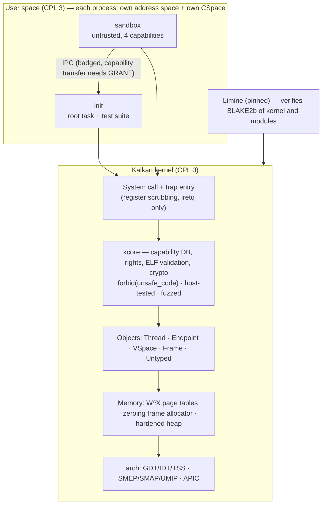

<div align="center">

# 🛡️ Kalkan

**A capability-based, security-first microkernel for x86-64, written in Rust.**

*Kalkan* is Turkish for *shield*.

[](https://github.com/D3XSIM/kalkan/actions/workflows/ci.yml)


[Türkçe README](README.tr.md) · [Architecture](docs/ARCHITECTURE.md) · [Threat model](docs/THREAT_MODEL.md) · [System calls](docs/SYSCALLS.md) · [Testing](docs/TESTING.md) · [Building](docs/BUILDING.md)

</div>

---

Kalkan is a small microkernel built around one idea: **nothing is trusted that can
be checked instead.** User programs hold no ambient authority — every kernel object
is reached through an unforgeable *capability* whose rights can only ever shrink.
The kernel verifies its own hardware protections at boot, verifies every program it
loads, audits its own data structures, and ships with an adversarial test suite in
which untrusted processes attack it from every angle on every CI run.

<p align="center">
  
</p>

<details>
<summary>The same run as text</summary>

```text
Kalkan v0.2.0 booting
[boot] bootloader: Limine 11.2.1
Security posture:
  [PASS] NX (no-execute pages)                  EFER.NXE
  [PASS] SMEP (no kernel exec of user pages)    CR4.SMEP
  [PASS] SMAP (no kernel access to user pages)  CR4.SMAP, never lifted
  [PASS] UMIP (hide descriptor tables)          CR4.UMIP
  [PASS] W^X kernel image                       .text R-X, .rodata R--, .data RW-
  [PASS] KASLR (kernel image)                   slide 0x52cf2000
Boot module integrity (BLAKE2b-512):
  [PASS] init      257672 bytes  2c1ba5134cd341d0...
  [PASS] sandbox   226736 bytes  21060fc06f774ce7...
[mm] kernel page tables active; direct map at 0xffffd1bec0000000; local APIC in x2APIC mode
[kernel] root task 'init' ready with 127 initial capabilities; 'sandbox' and 60 probe processes created (inactive); test kernel
[sandbox]   [BLOCKED] forge a different badge (identity spoofing) (EINVAL)
[sandbox]   [BLOCKED] smuggle a capability over IPC (its console capability)
[sandbox]   [BLOCKED] kill the root task without a thread capability (EEMPTY)
[init]   [PASS] sandbox escape attempts all refused (67 checks passed, 0 failed)
[init]   [PASS] read kernel code (killed: page fault at 0xffffffffd2cf2000, error 0x5)
[init]   [PASS] overwrite the kernel stack (killed: page fault at 0xfffffbae2e610ff8, error 0x7)
[init]   [PASS] read the kernel through the direct map of physical memory (killed: page fault at 0xffffd1becbfc2000, error 0x5)
[init]   [PASS] redirect the system call entry (wrmsr LSTAR) (killed: general protection fault)
[init]   [PASS] iretq into ring 0 (killed: general protection fault)
[probe53]   fuzzer: 24000 system calls, 1305 succeeded, errors by code [3491, 306, 4949, 8929, 10, 1488, 0, 194, 1512, 733, 0, 0, 55]
[init]   [PASS] a server that dies holding a call releases its caller (the call returned EDEAD)
[init]   [PASS] kill a process blocked in IPC (removed from the endpoint queue, everything reclaimed)
[init] KALKAN-TEST: PASS - all 143 security tests passed
[kernel] audit: object graph consistent (10 capabilities, 1 threads, 1 endpoints, 2 frames, 2 mappings, 9 page tables, 1 address spaces); 44890 audits passed, 702 with a full page-table walk
[kernel] system shut down cleanly
```

</details>

## Try it in one minute

No Rust toolchain needed. Download **`kalkan-demo-v0.2.0.zip`** from the
[latest release](https://github.com/D3XSIM/kalkan/releases/latest), unzip it and
run it in QEMU:

| System | Install QEMU | Run |
|---|---|---|
| Windows | `winget install SoftwareFreedomConservancy.QEMU` | double-click `run.cmd` |
| Debian / Ubuntu | `sudo apt install qemu-system-x86 ovmf` | `./run.sh` |
| Fedora | `sudo dnf install qemu-system-x86 edk2-ovmf` | `./run.sh` |
| macOS | `brew install qemu` | `./run.sh` |

In about half a minute you watch the kernel verify its own hardware protections
and boot modules, then hold out against untrusted processes that attack it from
every angle: 143 security tests in all. The package
holds a [test kernel](docs/ARCHITECTURE.md#test-kernels) — the exact configuration
CI checks — and the bootloader verifies every file in it against a BLAKE2b-512
digest before running it. To build the same package yourself: `cargo xtask dist`.

## Break it 🎯

Kalkan's claims are only worth something if they survive people trying to break
them. Can an untrusted process read or write kernel memory, forge a capability
or keep one after revocation, impersonate another process, crash or hang the
kernel, or learn a kernel address? Start from
[`user/sandbox`](user/sandbox/src), which already tries over 120 ways,
and please [report what you find privately](https://github.com/D3XSIM/kalkan/security/advisories/new).
Every confirmed finding is fixed in the open, gets a regression test in the suite,
and earns a place in the [hall of fame](SECURITY.md#hall-of-fame).

## Highlights

| | |
|---|---|
| 🔑 **Capabilities, no ambient authority** | seL4-style capability spaces, monotonic rights, unforgeable badges, a derivation tree with complete revocation, GRANT-based confinement. |
| 🦀 **Memory-safe by construction** | Rust, stable toolchain only. `unsafe` is *denied by the compiler* outside four low-level modules, and every `unsafe` block carries a `SAFETY:` justification (enforced by Clippy). |
| 🧪 **Policy you can test** | All access-control decisions live in [`kcore`](kcore/src/lib.rs): `#![forbid(unsafe_code)]`, zero dependencies, unit-tested and property-tested on the host, fuzzed in CI. |
| 🧱 **Hardware hardening, verified at boot** | NX, SMEP, SMAP (never lifted), UMIP, CR0.WP, CR4.TSD, no user SIMD, W^X everywhere, non-executable physmap, guard pages, KASLR — and the kernel *checks* each one by inspecting its own control registers and page tables. Fail-closed if a mandatory protection is missing. |
| 🔗 **Verified boot chain** | Pinned bootloader (tag + commit + BLAKE2b). The bootloader verifies kernel and modules; the kernel verifies modules **again** against digests compiled into it. Tampering is tested in CI. |
| ⚔️ **Adversarial test suite** | 143 boot-time security checks: a sandbox with 67 escape attempts, **54 probe processes** that each try one hardware-level attack (kernel code, data, stack, heap and physmap **at their real, randomised addresses**, W^X, privileged instructions, ring-0 returns, hostile stack/flags, ...), **6 process life-cycle tests** and a **system call fuzzer** — run on three machine sizes and in both local APIC modes, plus a production-kernel check and fail-closed and boot-tampering scenarios. |
| 🔍 **The kernel audits itself** | A built-in auditor recomputes every reference count, mapping counter, budget, queue, reply obligation and page-table entry from first principles, and walks every user page table to account for each present page. In test builds it runs after *every* trap — about 45 000 times per boot. |
| 📦 **Zero-dependency kernel** | No third-party crates in the kernel or its policy core; the supply chain is the Rust toolchain and one pinned bootloader binary. |

### By the numbers

| Component | Lines of Rust* | `unsafe` |
|---|---:|---|
| `kcore` — policy core | ~2 900 (more than half of it tests) | **forbidden** |
| `kernel/src/kernel` — objects, IPC, syscalls, loader, self-audit | ~1 800 | **denied** |
| `kernel/src/arch` + `boot.rs` + `sync.rs` | ~1 250 | allowed, every block justified |
| `kernel/src/mm` — memory management | ~1 050 | allowed, every block justified |
| `user/` — root task, sandbox, probes, fuzzer | ~2 900 | attack code only |
| Third-party crates in the kernel | 0 | — |

<sub>*non-blank, non-comment lines</sub>

## Architecture



* **Microkernel.** The kernel provides only address spaces, threads, IPC, memory
  objects and capabilities. Everything else belongs in user space.
* **Event-driven, single kernel stack.** Every trap is handled to completion with
  interrupts disabled; the kernel never blocks or sleeps. No kernel threads, no
  kernel-mode preemption, no lock juggling.
* **Rendezvous IPC** with `send` / `recv` / `call` / `reply`, kernel-assigned
  badges, optional capability transfer and kernel-generated fault messages.

Details: [docs/ARCHITECTURE.md](docs/ARCHITECTURE.md).

## Security model in one table

| Threat | Mitigation | Where |
|---|---|---|
| Privilege escalation via forged references | Capabilities are kernel objects addressed by slot; ids are generational | `kcore/src/cspace.rs`, `kcore/src/arena.rs` |
| Rights escalation | Derivation can only remove rights (exhaustively tested) | `kcore/src/rights.rs` |
| Capability leakage | Cross-CSpace transfer requires GRANT; revocation removes all descendants *and their mappings* | `kcore/src/cspace.rs`, `kernel/src/kernel/mod.rs` |
| Identity spoofing over IPC | Badges are set once by the minter and delivered by the kernel | `kernel/src/kernel/ipc.rs` |
| Kernel pointer passed to a syscall | The kernel never dereferences user pointers: it walks the target page tables and copies through the direct map | `kernel/src/mm/user.rs` |
| ret2usr / user data abuse | SMEP + SMAP, never lifted (no `stac` in the kernel) | `kernel/src/arch/x86_64/cpu.rs` |
| Code injection | W^X for kernel image, physmap, heap, stacks and user programs; W+X mappings are unrepresentable, and W^X holds per *frame* across aliases; the physmap alias of the kernel image is read-only | `kernel/src/mm/*`, `kcore/src/elf.rs` |
| Malformed executables | Strict, panic-free ELF validator (fuzzed); no interpreter, TLS, text relocations or dynamic linking | `kcore/src/elf.rs` |
| Address disclosure | KASLR; the kernel moves its direct map of physical memory to a random address; randomised kernel stack/heap/MMIO slots; user ASLR; UMIP; no addresses in the kernel log — all checked in CI | `kernel/src/mm/kspace.rs`, `kernel/src/kernel/loader.rs`, `kernel/src/log.rs` |
| Spectre v1 | Branch-free index clamping on syscall numbers and capability slots | `kcore/src/nospec.rs` |
| Spectre v2 / MDS / SWAPGS | IBRS + STIBP always on, IBPB on address-space switch, VERW on return (each when the CPU supports it; QEMU's emulated CPU lacks IBRS/STIBP), `lfence` after `swapgs` | `kernel/src/arch/x86_64/` |
| Speculative gadgets via stale registers | All GPRs zeroed on kernel entry | `kernel/src/arch/x86_64/entry.rs` |
| SYSRET privilege escalation (CVE-2012-0217) | Kernel always returns with `iretq`; RFLAGS/CS/SS sanitised | `kernel/src/arch/x86_64/entry.rs` |
| Debug trap on the syscall entry path (cf. CVE-2018-8897) | TF masked on `syscall`; `#DB` runs on its own IST stack; debug registers cleared | `kernel/src/arch/x86_64/` |
| Stray entry points | `sysenter` MSRs zeroed, no LDT, every IDT gate DPL 0, no I/O bitmap | `kernel/src/arch/x86_64/` |
| SIMD state leakage (LazyFP) | x87/SSE/AVX disabled for user space | `kernel/src/arch/x86_64/cpu.rs` |
| Cache-timing attacks | `rdtsc` restricted to ring 0 | `kernel/src/arch/x86_64/cpu.rs` |
| Information leaks via memory reuse | Frames zeroed on allocation *and* free; heap blocks zeroed; bootloader memory zeroed on reclaim | `kernel/src/mm/frame.rs`, `kernel/src/mm/heap.rs` |
| Heap corruption | Encoded (safe-linked) free lists, poisoning, double-free detection, guard pages — corruption panics | `kernel/src/mm/heap.rs` |
| Kernel stack overflow | Guard pages + IST stacks for #DF/NMI/#MC/#DB | `kernel/src/mm/kspace.rs` |
| Resource exhaustion | Untyped memory budgets with refunds and revocation; per-address-space page-table quota with reclamation; a frame reserve user space can never touch; hard limits on every kernel table, sized so that no process can exhaust them for the others | `kernel/src/kernel/mod.rs` |
| Stuck or zombie processes | A dead process returns its memory at once, even if nobody collects its report; calls that can no longer be answered return `EDEAD`; supervisors can `thread_kill` | `kernel/src/kernel/mod.rs`, `kernel/src/kernel/ipc.rs` |
| Integer overflow | `overflow-checks = true` in release builds; checked arithmetic on all untrusted input | `Cargo.toml` |
| Terminal injection | User console output is sanitised (no ESC / control characters) | `kernel/src/log.rs` |
| Boot-time tampering | Pinned bootloader; BLAKE2b verification by bootloader *and* kernel | `xtask/`, `kernel/src/main.rs` |
| Supply chain | Zero kernel dependencies, `cargo-deny`, CI actions pinned by commit SHA | `deny.toml`, `.github/workflows/ci.yml` |

What is **not** covered yet is just as important — see the
[threat model](docs/THREAT_MODEL.md#known-limitations).

## Quick start

You need Rust (via [rustup](https://rustup.rs)), QEMU and git. The pinned
toolchain from `rust-toolchain.toml` is installed automatically.

```sh
# Windows (PowerShell): winget install Rustlang.Rustup; winget install SoftwareFreedomConservancy.QEMU
# Ubuntu/Debian:        sudo apt install qemu-system-x86 ovmf
# macOS:                brew install qemu

cargo xtask run      # build a test kernel and boot it in QEMU
cargo xtask test     # every security scenario (what CI runs, ~2.5 min)
cargo xtask test --quick   # suite + one tamper test (~1 min)
cargo xtask build    # a normal kernel (no test facilities)
cargo xtask dist     # the demo package from the release page
cargo test -p kalkan-core   # host unit/property tests of the policy core
```

On Windows without Visual Studio, use the GNU host toolchain:
`rustup set default-host x86_64-pc-windows-gnu`. See [docs/BUILDING.md](docs/BUILDING.md).

## Repository layout

```text
kcore/            policy core: capabilities, rights, ELF validator, crypto (no unsafe, no deps)
kernel/
  src/arch/       x86-64: entry stubs, GDT/IDT/TSS, CPU hardening, APIC, entropy
  src/mm/         frame allocator, page tables, kernel address space, heap, user memory
  src/kernel/     objects, scheduler, IPC, system calls, program loader (no unsafe)
  src/boot.rs     Limine protocol (no third-party crate)
  src/posture.rs  boot-time security self check
  src/kernel/audit.rs   run-time self-audit of the whole object graph
user/
  libkalkan/      system call library
  init/           root task and the adversarial test suite
  sandbox/        the attacker: escape suite, 54 fault probes, life-cycle roles, fuzzer
xtask/            build, run and test orchestration (cargo xtask)
fuzz/             cargo-fuzz targets
docs/             architecture, threat model, system calls, testing, building
```

## Testing

| Layer | What it does | Command |
|---|---|---|
| Policy core | 54 host tests: exhaustive rights checks, a **differential test against an independent reference model** of the capability database, test vectors cross-checked with OpenSSL and Python's `hashlib`, ELF generators and mutation | `cargo test -p kalkan-core` |
| Stress | 1.9 million model steps, 2 million parser mutations | `cargo test -p kalkan-core --release -- --ignored` |
| Fuzzing | libFuzzer targets for the ELF validator and the capability database | `cargo +nightly fuzz run elf` |
| Static claims | No third-party packages, `unsafe` confined, no `stac`/`sysret`, CI pinned, docs match the ABI | `cargo xtask check` |
| Whole system | 143 checks in QEMU with a test kernel auditing itself after every trap; 128 MiB, 256 MiB and 5 GiB of RAM; local APIC in x2APIC and xAPIC mode | `cargo xtask test` |
| Production kernel | A kernel without the test facilities: no probe processes, no diagnostic system calls, no addresses in its log — and every test that does not need them passes | `cargo xtask test` |
| Randomisation | Kernel image, direct map, kernel regions and user programs must move between boots | `cargo xtask test` |
| Fail-closed | CPUs without NX, SMEP or SMAP must be refused | `cargo xtask test` |
| Boot integrity | Flipped, swapped, truncated, extra and missing modules, and a modified kernel, must never reach user space | `cargo xtask test` |
| Code quality | `rustfmt`, Clippy with `-D warnings`, `undocumented_unsafe_blocks = deny` | CI |

Details: [docs/TESTING.md](docs/TESTING.md).

## How Kalkan was built

Kalkan was written by AI coding agents (Anthropic's Claude, working through Claude
Code) at the direction of its maintainer. That is a reason for **more** scrutiny,
not less, so nothing here asks to be trusted on its author's word:

* every security claim in this README is backed by a test that runs on every commit;
* the limitations are listed openly in the [threat model](docs/THREAT_MODEL.md#known-limitations);
* the history shows the work in the open, including the bugs that reviews found
  and the tests that now guard against them ([CHANGELOG](CHANGELOG.md)).

Independent human review is the most valuable contribution you can make — see
[Break it](#break-it-) and [CONTRIBUTING.md](CONTRIBUTING.md).

## Roadmap

- [ ] SMP support (per-CPU kernel stacks, IPIs, TLB shootdown)
- [ ] User-space process creation (Thread/VSpace retype) and a user-level ELF loader
- [ ] IOMMU (VT-d/AMD-Vi) to confine DMA, user-space drivers via IRQ capabilities
- [ ] Eager XSAVE so user space can use SIMD safely
- [ ] KPTI for Meltdown-affected CPUs, CET shadow stacks, kernel CFI
- [ ] Notification objects, timeouts, priorities
- [ ] Formal specification of the capability model

## Disclaimer

Kalkan is an educational and research project. It has not been formally verified
or audited by a third party and must not be relied on to protect real data. Please
report security issues as described in [SECURITY.md](SECURITY.md).

## License

Dual-licensed under [MIT](LICENSE-MIT) or [Apache-2.0](LICENSE-APACHE), at your option.
