<div align="center">

# 🛡️ Kalkan

**x86-64 için Rust ile yazılmış, yetki (capability) tabanlı, güvenlik odaklı bir mikroçekirdek.**

[English README](README.md) · [Mimari](docs/ARCHITECTURE.md) · [Tehdit modeli](docs/THREAT_MODEL.md) · [Sistem çağrıları](docs/SYSCALLS.md) · [Testler](docs/TESTING.md) · [Derleme](docs/BUILDING.md)

</div>

---

Kalkan tek bir fikir üzerine kurulu küçük bir mikroçekirdektir: **doğrulanabilen
hiçbir şeye güvenilmez.** Kullanıcı programlarının "varsayılan yetkisi" (ambient
authority) yoktur; her çekirdek nesnesine yalnızca sahte üretilemeyen bir
*capability* (yetki jetonu) ile erişilir ve bu jetonun hakları yalnızca
**azaltılabilir**. Çekirdek açılışta kendi donanım korumalarını doğrular, yüklediği
her programı doğrular ve her CI çalıştırmasında güvenilmeyen bir sürecin
sandbox'tan kaçmaya çalıştığı saldırgan bir test paketiyle gelir.

<p align="center">
  
</p>

## Bir dakikada dene

Rust kurmana gerek yok. [Son sürüm sayfasından](https://github.com/D3XSIM/kalkan/releases/latest)
**`kalkan-demo-v0.2.0.zip`** dosyasını indir, zip'ten çıkar ve QEMU ile çalıştır:

| Sistem | QEMU kurulumu | Çalıştırma |
|---|---|---|
| Windows | `winget install SoftwareFreedomConservancy.QEMU` | `run.cmd` dosyasına çift tıkla |
| Debian / Ubuntu | `sudo apt install qemu-system-x86 ovmf` | `./run.sh` |
| Fedora | `sudo dnf install qemu-system-x86 edk2-ovmf` | `./run.sh` |
| macOS | `brew install qemu` | `./run.sh` |

Yaklaşık yarım dakikada çekirdeğin kendi donanım korumalarını ve açılış
modüllerini doğrulamasını, ardından her yönden saldıran güvenilmeyen süreçlere
karşı koymasını izlersin: toplam 143 güvenlik testi. Paketteki çekirdek bir [test çekirdeğidir](docs/ARCHITECTURE.md#test-kernels)
(CI'ın denetlediği yapılandırmanın aynısı); önyükleyici içindeki her dosyayı
çalıştırmadan önce BLAKE2b-512 özetiyle doğrular. Aynı paketi kendin üretmek için:
`cargo xtask dist`.

## Kır beni 🎯

Kalkan'ın iddiaları ancak onu kırmaya çalışanlara dayanırsa bir değer taşır.
Güvenilmeyen bir süreç çekirdek belleğini okuyabiliyor ya da yazabiliyor, bir
yetkiyi taklit edebiliyor ya da geri alındıktan sonra tutabiliyor, başka bir
süreç kılığına girebiliyor, çekirdeği çökertebiliyor ya da kilitleyebiliyor,
veya bir çekirdek adresini öğrenebiliyor mu? Zaten 120'den fazla yolu deneyen
[`user/sandbox`](user/sandbox/src) ile başla ve bulduğunu
[gizlice bildir](https://github.com/D3XSIM/kalkan/security/advisories/new).
Doğrulanan her bulgu açıkça düzeltilir, test paketine bir regresyon testi olarak
eklenir ve bulan kişi [onur listesine](SECURITY.md#hall-of-fame) yazılır.

## Kalkan nasıl yapıldı

Kalkan, sahibinin yönlendirmesiyle yapay zekâ kodlama ajanları (Anthropic'in
Claude modeli, Claude Code aracılığıyla) tarafından yazıldı. Bu, **daha fazla**
inceleme için bir sebep; bu yüzden burada hiçbir şey yazarının sözüne güvenilerek
kabul edilmiyor:

* README'deki her güvenlik iddiası, her commit'te çalışan bir testle desteklenir;
* sınırlamalar [tehdit modelinde](docs/THREAT_MODEL.md#known-limitations) açıkça
  listelenir;
* geçmiş açıktır: incelemelerde bulunan hatalar ve artık onlara karşı koruyan
  testler [CHANGELOG](CHANGELOG.md) içinde görülebilir.

Yapabileceğin en değerli katkı, bağımsız bir insan incelemesidir.

## Öne çıkanlar

- 🔑 **Capability modeli, varsayılan yetki yok** — seL4 tarzı yetki alanları
  (CSpace), monoton haklar, taklit edilemeyen "badge"ler, türetme ağacı ile tam
  geri alma (revoke), GRANT hakkına dayalı hapsetme (confinement).
- 🦀 **Yapısı gereği bellek güvenli** — Rust, yalnızca stable derleyici. `unsafe`
  kod dört alt seviye modül dışında **derleyici tarafından yasaklanmıştır**; her
  `unsafe` bloğunun bir `SAFETY:` gerekçesi vardır (Clippy ile zorunlu).
- 🧪 **Test edilebilir politika** — Tüm erişim kararları [`kcore`](kcore/src/lib.rs)
  içindedir: `#![forbid(unsafe_code)]`, sıfır bağımlılık, bilgisayarda birim ve
  özellik (property) testleri, CI'da fuzzing.
- 🧱 **Açılışta doğrulanan donanım sertleştirmesi** — NX, SMEP, SMAP (hiç
  kaldırılmaz), UMIP, CR0.WP, CR4.TSD, kullanıcıya kapalı SIMD, her yerde W^X,
  çalıştırılamaz fiziksel bellek haritası, koruma sayfaları, KASLR. Çekirdek her
  birini kendi kontrol yazmaçlarını ve sayfa tablolarını okuyarak **kontrol eder**;
  zorunlu bir koruma yoksa açılmayı reddeder (fail-closed).
- 🔗 **Doğrulanmış açılış zinciri** — Sürümü, commit'i ve BLAKE2b özeti
  sabitlenmiş önyükleyici. Önyükleyici çekirdeği ve modülleri doğrular; çekirdek
  modülleri içine gömülü özetlerle **bir kez daha** doğrular. Kurcalama CI'da test
  edilir.
- ⚔️ **Saldırgan test paketi** — 143 açılış zamanı güvenlik kontrolü: 67 kaçış
  denemesi yapan bir sandbox, her biri tek bir donanım düzeyi saldırı deneyen
  **54 sonda süreci** (çekirdeğin kodu, verisi, yığını, heap'i ve fiziksel bellek
  haritası — **gerçek, rastgele adreslerinde** —, W^X, ayrıcalıklı komutlar, ring
  0'a dönüş, düşmanca yığın/bayraklar...), **6 süreç yaşam döngüsü testi** ve bir
  **sistem çağrısı fuzzer'ı**. Üç farklı bellek boyutunda ve iki APIC kipinde
  (x2APIC/xAPIC), ayrıca üretim çekirdeği, "korumasız işlemcide açılmama" ve
  önyükleme kurcalama senaryolarıyla çalışır.
- 🔍 **Çekirdek kendini denetler** — Yerleşik denetçi tüm referans sayaçlarını,
  eşleme sayaçlarını, bütçeleri, kuyrukları, yanıt borçlarını ve sayfa tablosu
  girdilerini sıfırdan yeniden hesaplar; kullanıcı sayfa tablolarını da tek tek
  gezip her sayfanın hesabını sorar. Test derlemelerinde **her** tuzaktan (trap)
  sonra çalışır: açılış başına yaklaşık 45.000 kez.
- 🧰 **Test çekirdeği ayrı** — Sonda süreçleri, tanı amaçlı sistem çağrıları ve
  günlükte adres gösterimi yalnızca `selftest` özelliğiyle derlenen test
  çekirdeklerinde vardır. Normal çekirdek hiçbir adresi günlüğe yazmaz (`<hidden>`);
  CI bunu da ayrıca açıp doğrular.
- 📦 **Sıfır bağımlılık** — Çekirdekte ve politika çekirdeğinde üçüncü taraf crate
  yok.

## Hızlı başlangıç

Rust ([rustup](https://rustup.rs)), QEMU ve git gerekir. `rust-toolchain.toml`
içindeki sabit derleyici sürümü otomatik kurulur.

```powershell
winget install Rustlang.Rustup
winget install SoftwareFreedomConservancy.QEMU
rustup set default-host x86_64-pc-windows-gnu   # Visual Studio yoksa
```

```sh
cargo xtask run             # bir test çekirdeği derle ve QEMU'da aç
cargo xtask test            # tüm güvenlik senaryoları (CI'ın çalıştırdığı, ~2,5 dk)
cargo xtask test --quick    # paket + bir kurcalama testi (~1 dk)
cargo xtask build           # normal çekirdek (test olanakları olmadan)
cargo xtask dist            # sürüm sayfasındaki demo paketi
cargo test -p kalkan-core   # politika çekirdeğinin birim/özellik testleri
```

Linux: `sudo apt install qemu-system-x86 ovmf` · macOS: `brew install qemu`.
Ayrıntılar: [docs/BUILDING.md](docs/BUILDING.md).

## Güvenlik modeli (özet)

| Tehdit | Önlem |
|---|---|
| Sahte referansla yetki yükseltme | Yetkiler çekirdek nesneleridir, slot numarasıyla adreslenir; kimlikler nesil sayaçlıdır |
| Hak yükseltme | Türetme yalnızca hak kaldırabilir (tüm kombinasyonlar test edilir) |
| Yetki sızdırma | Başka bir CSpace'e aktarım GRANT hakkı ister; revoke tüm alt yetkileri **ve eşlemelerini** siler |
| IPC'de kimlik taklidi | Badge bir kez atanır ve çekirdek tarafından iletilir |
| Sistem çağrısına çekirdek işaretçisi | Çekirdek kullanıcı işaretçilerini asla doğrudan okumaz; sayfa tablolarını yürüyüp doğrudan harita üzerinden kopyalar |
| ret2usr | SMEP + SMAP, hiç kaldırılmaz (çekirdekte `stac` yok) |
| Kod enjeksiyonu | Çekirdek imajı, fiziksel harita, heap, yığınlar ve kullanıcı programlarında W^X; W^X takma adlar (alias) üzerinden de çerçeve başına korunur |
| Bozuk/kötü niyetli çalıştırılabilir | Katı, panik üretmeyen, fuzz edilen ELF doğrulayıcı |
| Adres sızıntısı | KASLR; çekirdek fiziksel bellek haritasını rastgele bir adrese taşır; rastgele çekirdek yığın/heap/MMIO yerleşimi; kullanıcı ASLR; UMIP; çekirdek günlüğünde adres yok — hepsi CI'da doğrulanır |
| Spectre v1/v2, MDS, SWAPGS | Dalsız indeks kısıtlama, IBPB, VERW, `swapgs` sonrası `lfence`, girişte tüm yazmaçların sıfırlanması |
| SYSRET açığı (CVE-2012-0217) | Çekirdek her zaman `iretq` ile döner |
| SIMD durum sızıntısı (LazyFP) | Kullanıcıya x87/SSE/AVX kapalı |
| Bellek yeniden kullanımıyla sızıntı | Çerçeveler ayırmada **ve** serbest bırakmada sıfırlanır |
| Heap bozulması | Kodlanmış serbest listeler, zehirleme, çift serbest bırakma tespiti, koruma sayfaları |
| Kaynak tüketme | Geri alınabilir untyped bellek bütçeleri, adres alanı başına sayfa tablosu kotası (boşalan tablolar geri alınır), kullanıcının dokunamadığı çekirdek bellek rezervi ve her çekirdek tablosunda, hiçbir sürecin başkaları için tüketemeyeceği büyüklükte sert sınırlar |
| Takılı kalan / zombi süreçler | Ölen süreç raporu hiç okunmasa bile belleğini hemen geri verir; artık yanıtlanamayacak çağrılar `EDEAD` ile döner; yöneticiler `thread_kill` ile süreç sonlandırabilir |
| Varsayılan rastgelelik | Rastgele sayı da bir yetkidir: `random` için entropi capability'si gerekir |
| Terminal enjeksiyonu | Kullanıcı konsol çıktısı temizlenir (ESC/kontrol karakteri yok) |
| Açılışta kurcalama | Sabitlenmiş önyükleyici; BLAKE2b doğrulaması hem önyükleyicide hem çekirdekte |

Henüz kapsanmayanlar (SMP, IOMMU, KPTI, Secure Boot, gerçek donanımda test, ...)
[tehdit modelinde](docs/THREAT_MODEL.md#known-limitations) açıkça listelenmiştir.

## Uyarı

Kalkan eğitim ve araştırma amaçlı bir projedir. Biçimsel olarak doğrulanmamış ve
bağımsız bir denetimden geçmemiştir; gerçek verileri korumak için kullanılmamalıdır.
Güvenlik açıklarını [SECURITY.md](SECURITY.md) içinde anlatıldığı şekilde bildirin.

## Lisans

[MIT](LICENSE-MIT) veya [Apache-2.0](LICENSE-APACHE), tercihinize göre.
